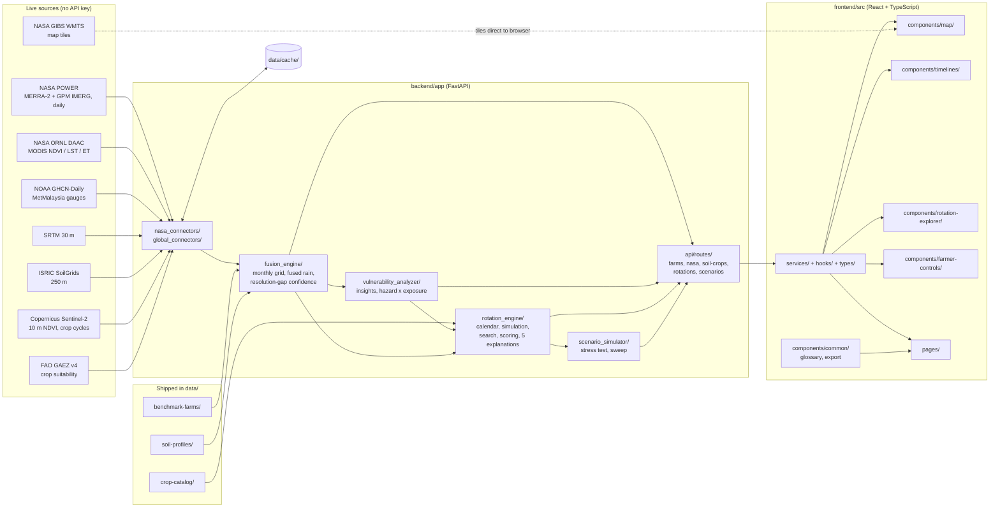

# Kebunda architecture

## System diagram

## Request flow: "compare rotations for this field"

1. `POST /api/v1/rotations/compare` with a field id, priorities and constraints.
2. `analysis.bundle(field)` loads the field's observations (stored for benchmarks, pulled
   live for a custom coordinate) and derives, once per field: fused rainfall, the layer
   inventory with resolution-gap confidence, and plain-language insights.
3. `rotation_engine.context.build_context` turns that into a `FieldContext` (monthly
   climate, soil hydraulics, slope, irrigation, equipment), applying a scenario if given.
4. `engine.evaluate_candidates` screens crops, enumerates sequences, simulates a few
   hundred rotations and caches the set (keyed by field, scenario and constraints).
5. `engine.select_strategies` ranks with the farmer's priorities and picks the baseline plus
   up to four distinct alternatives; each is re-simulated with the 24-year weather replay.
6. `vulnerability_analyzer.calendar` builds each strategy's hazard × exposure grid;
   `explain.build_explanation` writes the five explanations from the numbers.

Typical timings on a laptop: first compare for a field about 0.5-1 s; a priority change
30-60 ms; a stress test about 100 ms; a custom field's first load a few seconds (live
pulls), then cached.

## Backend layout

| Path | Responsibility |
| --- | --- |
| `app/main.py` | App factory, CORS, gzip, router mounting, cache warm-up at start |
| `app/config.py` | Settings from `.env` (all optional) |
| `app/api/routes/<group>/router.py` | One router per group; folders are auto-discovered, so adding a group is adding a folder |
| `app/api/middleware/` | Uniform JSON errors; request timing header |
| `app/models/schemas/` | Pydantic request and response models: the API contract |
| `app/services/nasa_connectors/` | `power`, `land_products` (MODIS/VIIRS/SMAP subsets), `terrain` (SRTM), `gibs`, `missions` (SMAP, ECOSTRESS, GRACE adapters), shared `base` (HTTP, cache, provenance) |
| `app/services/global_connectors/` | `soilgrids` (soil), `gaez` (FAO crop suitability), `sentinel2` (NDVI and crop cycles), `ghcn` (MetMalaysia gauges), `markets` (FAMA/DOA prices) |
| `app/services/fusion_engine/` | `observe` (collect layers), `climate` (monthly grid), `harmonize` (fusion, downscaling, confidence) |
| `app/services/vulnerability_analyzer/` | `insights` (facts), `calendar` (risk grid, NDVI validation) |
| `app/services/rotation_engine/` | `context`, `schedule`, `simulate`, `generate`, `scoring`, `engine`, `explain` |
| `app/services/scenario_simulator/` | `simulator` (limits, presets, stress test, sweep) |
| `app/services/analysis.py`, `field_store.py` | Use-case orchestration; benchmark and custom field storage |
| `scripts/` | `build_benchmark_data` (pull real observations into `data/`), `export_contracts` |
| `tests/` | 69 offline tests: connectors (mocked HTTP), models, engine, scenarios, API |

### Resilience rules

- Every outbound call goes through `nasa_connectors/base.fetch`: cached on disk, retried
  with backoff, falls back to a stale cache entry, and never retries a 4xx.
- Every layer is optional. A failed source is recorded in `issues`, lowers confidence, and
  shows up as an information gap. Only NASA POWER is required for a custom field.
- Benchmark farms never need the network at runtime.
- `KEBUNDA_OFFLINE=1` forbids outbound requests entirely (tests, demos without wifi).
- Every number carries provenance: `live`, `cache`, `curated`, `proxy` or `unavailable`.

## Data layout

| Path | Contents | How it is made |
| --- | --- | --- |
| `data/benchmark-farms/<id>.json` | Farm definition: location, management, baseline rotation, local yields and buyers, water context | Curated by hand |
| `data/benchmark-farms/observations/<id>.json` | Harmonised observation layers for that coordinate | `python -m scripts.build_benchmark_data` |
| `data/soil-profiles/<id>.json` | SoilGrids profile under the field, with any `soil_overrides` from the farm file (surveyed peat, BRIS sand) | same script |
| `data/crop-catalog/crops.json` | 19 Malaysian crops and cover crops with agronomic and economic traits (RM/ha) | Curated |
| `data/cache/` | Raw responses from live services | Runtime, gitignored |

## Frontend layout and ownership

| Path | Owner | Extension point |
| --- | --- | --- |
| `src/types/`, `services/`, `hooks/`, `styles/` | Shared foundation | Add fields to `types/api.ts` with the backend schema |
| `components/map/` | Member 2 | `layers/layerRegistry.ts`, `overlays/overlayRegistry.tsx` |
| `components/timelines/` | Member 2 | `timelineRegistry.tsx`, `chartKit.tsx` |
| `components/rotation-explorer/` | Member 3 | `evidence-panels/panelRegistry.tsx`, `cards/`, `sequence-builder/` |
| `components/farmer-controls/` | Member 3 | `priority-sliders/`, `scenario-sliders/` |
| `components/common/` | Member 3 | `glossary/glossaryData.ts`, `export/briefTemplates.ts`, `ui.tsx` |
| `pages/` | Member 3 | `pageRegistry.tsx` |

State lives in three places only: server data in `hooks/useData.ts` (cached by request
key), farmer inputs in `hooks/useKebunda.tsx` (context), and local UI state inside
components. Components never call `fetch`.

## Design decisions

- **Real data over mock data.** Benchmark observations are actual pulls for actual
  coordinates; the Kedah paddy point was moved after Sentinel-2 showed the first pixel was not
  double-cropped paddy, and two SoilGrids profiles were replaced with surveyed peat and sand.
- **Simple, inspectable models over a black box.** Every sentence in an explanation is
  assembled from a number in the same payload.
- **Fixed score anchors**, so scores are comparable across fields and do not jump when the
  candidate set changes.
- **Cache simulations, not rankings**, so priority sliders are instant.
- **Registries at every seam** (routes, map layers, overlays, timelines, panels, glossary,
  export templates, pages) so three people can add features without editing shared files.
